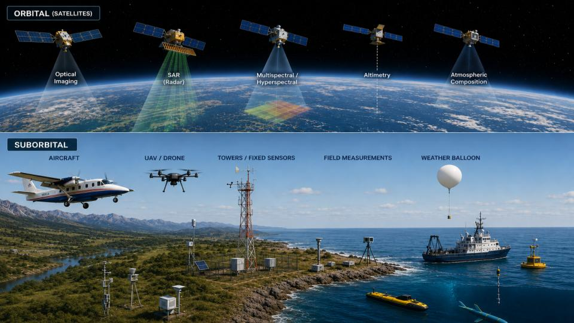
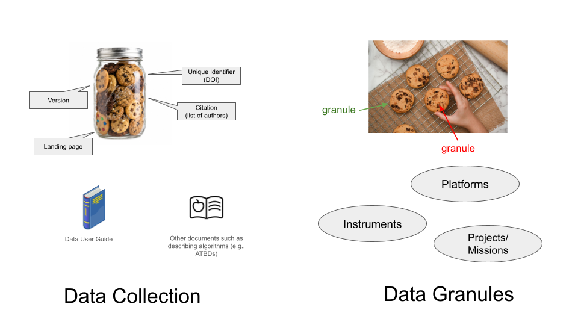

## Overview

::: {style="text-align:center;"}
{fig-alt="Illustration comparing orbital and suborbital Earth observations. Above, satellites collect optical, radar, multispectral and hyperspectral, altimetry, and atmospheric composition measurements. Below, aircraft, drones, towers, field instruments, a weather balloon, a research vessel, buoys, and aquatic vehicles illustrate the variety of suborbital observation platforms across land, air, and water." fig-align="center"}
:::

Suborbital observations are collected under highly variable conditions, making
metadata essential for understanding the data. The same instrument can be
mounted on different platforms, at different altitude or depth, swath widths,
and spatial coverage. Instruments, calibration procedures, sampling methods,
and environmental conditions may also vary across campaigns. Enriched metadata
captures these details, supporting data interpretation, discoverability, and
reuse.

Here is our [**POP**](https://rockwoodleadership.org/pop-everything-strategic-planning-in-30-seconds-or-less/)(Purpose, Outcomes, Process):

- **Purpose:** Provide a foundation for understanding metadata for suborbital
missions: why it matters, what it should describe, and how it supports
discoverability, reuse and reproducibility. This notebook is a starting point
for data producers learning how metadata is structured, why it matters
for suborbital observations, and how it supports data discovery and reuse. It
provides a foundation for further resources on collecting and registering
metadata.

- **Outcomes:** By the end of this notebook, you’ll be able to recognize key
elements of suborbital metadata, explain their importance, and describe how
incomplete or unclear metadata can limit the use of a dataset. 

- **Process:** Plan for about 45–60 minutes. This notebook is based on the 
presentation [Metadata for Suborbital Data Publication](https://docs.google.com/presentation/d/1-flozA_ph9tBzqatoOs69lD8NpcfiIZ6VFeP2MDINmk/edit?usp=sharing)
Rupesh Shrestha and Michele Thornton (ORNL DAAC) first shared at [2026 NASA-Openscapes
Champions](https://github.com/NASA-Openscapes/2026-nasa-champions)

## Learning objectives

- Explain what distinguishes suborbital (airborne/field campaign) data from satellite data, and why that affects how its metadata is structured.
- Distinguish collection-level metadata (UMM-C) from granule-level metadata (UMM-G) in CMR, and know what GCMD science keywords are for.
- Search CMR with `earthaccess` for a suborbital collection by campaign, platform, instrument, or science keyword.
- Locate and interpret platform, instrument, campaign, spatial/temporal extent, and processing information for a collection and its granules.
- Access and open a suborbital granule from the cloud, and inspect its variables, units, and structure.

## Prerequisites

| Concepts | Importance | Notes |
| --- | --- | --- |
| [Earthdata Login account](https://urs.earthdata.nasa.gov/users/new) | Optional for this notebook | Searching public collection and granule metadata does not require login. An account is needed when downloading or streaming data through `earthaccess`. See the [Authentication appendix](https://nasa-openscapes.github.io/earthdata-cloud-cookbook/appendix/authentication.html) for setup help. |
| [Intro to earthaccess](https://earthaccess.readthedocs.io/en/stable/quick-start/) | Necessary | Used throughout this notebook to search CMR and open cloud data. |
| [How do I find data using code?](https://nasa-openscapes.github.io/earthdata-cloud-cookbook/how-tos/find-data/programmatic.html) | Helpful | Covers the general `earthaccess`/CMR search pattern this notebook builds on. |
| [Understanding of NetCDF](https://foundations.projectpythia.org/core/data-formats/netcdf-cf) | Helpful | |
| Basic familiarity with `xarray` | Helpful | Used to open and inspect the sample granule. |


- **Time to learn**: ~45–60 minutes.

---

## Imports

```{python}
import earthaccess
import xarray as xr
from pprint import pprint
```

## What makes suborbital data different

Suborbital campaigns can bring together observations from aircraft, ships,
towers, and field sampling sites. Within a single campaign, researchers may use
several instruments across different platforms, locations, and periods.
Understanding these observations requires metadata that identifies how each
measurement fits into the broader effort.

Three concepts help describe these relationships:

- [Platform](https://wiki.earthdata.nasa.gov/spaces/CMR/pages/107390980/Platform): The vehicle or
structure from which observations are collected, such as an aircraft, ship, or
tower.
- [Instrument](https://www.earthdata.nasa.gov/data/instruments): The sensor or
equipment used to collect measurements.
- [Project](https://wiki.earthdata.nasa.gov/spaces/CMR/pages/118132538/Project): The scientific
effort associated with the data. In CMR, this can include a field campaign,
mission, investigation, or broader research program.

A single project may involve several platforms, each carrying multiple
instruments. The same instrument may also be used on different platforms or in
different campaigns. Recording these relationships helps users understand which
observations belong together and how they were collected.

Two ORNL DAAC collections illustrate this well:

| Metadata | [CARVE L1 FTS spectral radiances](https://doi.org/10.3334/ORNLDAAC/1426) | [AVIRIS-Classic L2 reflectance, V1](https://doi.org/10.3334/ORNLDAAC/2154) |
|---|---|---|
| Platforms listed | C-23 Sherpa | NOAA Twin Otter; NASA ER-2; NASA WB-57F |
| Instrument listed | Fourier Transform Spectrometers (FTS) | AVIRIS |
| Collection scope | FTS observations from CARVE flights, 2012–2015 | Facility instrument archive combining observations across aircraft and years |

These collections illustrate different ways observations can be grouped. The
[CARVE](https://www.earthdata.nasa.gov/data/projects/carve) FTS collection contains measurements from one instrument on one aircraft,
while the AVIRIS-Classic collection includes observations from an instrument
deployed on multiple aircraft. The collection-level platform list describes the
collection as a whole; it does not identify which aircraft produced each
individual file. To understand a particular observation, users may need to
consult its granule metadata, information within the data file, and supporting
documentation.

## Set up your environment

### Earthdata Login: when is it needed?

You can search public collection and granule metadata with
`earthaccess.search_datasets()` and `earthaccess.search_data()` without signing
in. The metadata inspection steps in this notebook do not require authentication.

If you continue to downloading or streaming data files with `earthaccess`,
you will need an [Earthdata Login account](https://urs.earthdata.nasa.gov/users/new)
and can authenticate with the optional step below. See the
[earthaccess authentication documentation](https://earthaccess.readthedocs.io/en/stable/user/explanation/authenticate/)
for details.

```{python}
# Optional: run before downloading or streaming data files.
auth = earthaccess.login(persist=True)
```

## Understanding the metadata

### Collections and granules

To understand how data are described in NASA’s Common Metadata Repository
(CMR), we’ll focus on two levels: collections and granules. 

- A **collection** describes a dataset as a whole — for example, "BioSCape:
AVIRIS-NG L3 Resampled Reflectance Mosaics, V2." It tells you what the dataset
is, who produced it, what instrument and platform were involved, and the
overall spatial/temporal coverage.

- A **granule** is an individual data unit within a collection and may contain
one or several files. In this BioSCape collection, a granule represents a
mosaic tile that combines observations from multiple flight lines and days.
It groups reflectance, uncertainty, and associated files. Granule metadata
describes that tile's spatial and temporal coverage and provides access links
to its files.



`earthaccess` has a separate search function for each level:
`earthaccess.search_datasets()` searches collections, and 
`earthaccess.search_data()` searches granules.

We will explore how the metadata from a collection and from a granule looks
like in the next sections.

### CMR, UMM-C, UMM-G, and GCMD keywords

A few acronyms come up constantly when working with this metadata:

- **CMR** (Common Metadata Repository) is the system that stores and provides
access to metadata. Tools such as `earthaccess` and [Earthdata
Search](https://search.earthdata.nasa.gov) query CMR to help users find data. 
- **UMM** (Unified Metadata Model) defines metadata fields and how they are organized.
  - **UMM-C** (Unified Metadata Model – Collection) is the schema 
  collection-level metadata follows: platforms, instruments, science keywords, 
  spatial/temporal coverage, citation information, and more.
  - **UMM-G** (Unified Metadata Model – Granule) is the schema granule-level 
  metadata follows: a specific granule's spatial/temporal extent and data access 
  links.
- [**GCMD keywords**](https://www.earthdata.nasa.gov/data/tools/gcmd-keyword-viewer) (Global Change Master Directory) provide standardized terms
for describing science topics, platforms, instruments, projects, and more.
These controlled vocabularies help producers describe data consistently and
help users find related datasets.

### Where to find user guides, versions, and citations

A collection’s metadata record can help you locate its DOI, citation
information, and supporting documentation. Follow the DOI to the dataset’s
landing page, where you can find the recommended citation, dataset version, and
links to user guides. For example, [BioSCape: AVIRIS-NG L3 Resampled
Reflectance Mosaics, V2](https://doi.org/10.3334/ORNLDAAC/2427) contains mosaics of surface reflectance observations
collected for the BioSCape project. Its [user
guide](https://data.ornldaac.earthdata.nasa.gov/public/bioscape/BioSCape_ANG_V02_L3_RFL_Mosaic/comp/BioSCape_ANG_V02_L3_RFL_Mosaic.pdf)
provides information about the data files and how the mosaics were produced.
Here, L3 identifies the processing level, while V2 identifies the dataset
version. Check that the documentation applies to the version you are using, and
use the recommended dataset citation. For data producers, metadata and
documentation work together: the metadata helps people discover and evaluate
the dataset, while the user guide explains how to interpret and use it. Keep
both consistent when releasing updates.

::: {.callout-tip}
Always check a dataset's user guide and DOI landing page alongside
its structured metadata. User guides often provide additional detail
about calibration, processing methods, known issues, and limitations
that is important for interpreting and using the data.
The user guide will also describe the file naming conventions / the elements comprising the file name.
:::

## Discover a suborbital collection

The metadata fields introduced above become the search criteria we use to find
data. With `earthaccess`, we can discover suborbital collections by instrument,
project, geographic area, and time period.

The CARVE and AVIRIS-Classic examples illustrated how platform and instrument
relationships can differ between collections. For the following walkthrough, we
will use a BioSCape AVIRIS-NG collection to explore how those concepts appear in
collection and granule metadata.

### Search by project, platform, instrument, or keyword

Collection metadata allows us to search by project or campaign, platform,
instrument, and science keywords. Here, we search for
collections associated with **BioSCape** and the **AVIRIS-NG** instrument.

We will use the `earthaccess.search_datasets()` function to get collections
related to those two terms and return the title of the elements found:

```{python}
collections = earthaccess.search_datasets(
    project="BIOSCAPE",
    instrument="AVIRIS-NG"
)

print(f"Found {len(collections)} collections:")
print()
for candidate in collections:
    print(candidate["umm"]["EntryTitle"])
    print("DOI:", candidate["umm"].get("DOI", {}))
    print()
```

These titles help us identify the different products available. The project
and instrument information supplied by data producers makes this search
possible.

### Inspect candidate collection metadata

For this example, we will use
[*BioSCape: AVIRIS-NG L3 Resampled Reflectance Mosaics, V2*](https://doi.org/10.3334/ORNLDAAC/2427).

We can retrieve its collection metadata record using the DOI printed above.
This would print a long output, which you can display by clicking on
_show collection metadata_. 

```{python}
collection = earthaccess.search_datasets(
    doi="10.3334/ORNLDAAC/2427",
    version="2",
)[0]
```

::: {.callout-note collapse="true" title="Show collection metadata"}
```{python}
pprint(dict(collection))
```
::: 

We can check the main records of the collection with:

```{python}
list(collection.keys())
```

As you can see in the print collection metadata above, there are two main
keys with **meta** and **umm**. We can check them out:

A metadata record is organized into named fields called keys. Each key has a
value, which may be text, a number, a list, or another group of fields. This
record has two main sections:

- **meta** contains information about the record in CMR, such as its identifier and
revision date.
- **umm** contains the scientific and descriptive metadata about the 
dataset, such as its title, instruments, coverage, and processing level.

```{python}
list(collection["meta"].keys())
```

```{python}
list(collection["umm"].keys())
```

We can select fields within umm to answer questions about the dataset. First,
what does this collection contain? Its abstract provides an overview:

```{python}
print(collection["umm"]["Abstract"])
```

The abstract tells us that this collection contains mosaic tiles combining
observations from multiple flight lines and days. It also identifies the
available file types: NetCDF data, TIFF quicklook images, and a GeoJSON tile
index. We should follow the [DOI](https://doi.org/10.3334/ORNLDAAC/2427) to
review the user guide and recommended citation. The guide provides additional
details about how the mosaics were produced and their limitations, helping you
decide whether the data meet your needs.

We can answer other questions such as:

 - What science topics is this collection indexed under?

```{python}
collection["umm"]["ScienceKeywords"]
```

Science keywords are standardized terms that help users discover related
datasets. They do not provide a complete inventory of measured variables;
consult the data files and user guide for variables, units, and measurement
details. As a data producer, choose keywords that accurately describe your
dataset's science topics so users can find it.

 -  When were the observations collected?

```{python}
collection["umm"]["TemporalExtents"]
```

 - What geographic area does the collection cover?

```{python}
collection["umm"]["SpatialExtent"]
```

:::{.callout-note}
The bounding rectangle describes the collection’s overall geographic extent.
It does not mean that observations cover every location inside that rectangle.
:::

 - What processing level is reported for this collection?

```{python}
collection["umm"]["ProcessingLevel"]
```

 - What is the version of this collection?

```{python}
collection["umm"]["Version"]
```

:::{.callout-note}
Processing level indicates a broad category of processing, while version
identifies the dataset release. For this collection, those are Level 3 and
Version 2. The user guide describes the methods, algorithms, and processing
steps used to generate the product.

As a data producer, record the processing level and document how the product
was generated. Users need both to judge whether the data suit their analysis.
:::

### Connect platforms, instruments, and projects

Which platforms and instruments are associated with this collection?

```{python}
pprint(collection["umm"].get("Platforms", []))
```

Each platform entry can include an `Instruments` list describing the
instruments associated with that platform. Find the aircraft name in the
output, then inspect its nested instruments to identify the sensor it carried.
This structure preserves the platform–instrument relationship introduced
earlier.

Which project is the collection associated with?

```{python}
pprint(collection["umm"].get("Projects", []))
```

Compare the project's `ShortName` with `project="BIOSCAPE"` in our earlier
search. Project metadata connects the collection to the broader scientific
effort and enables users to search for its datasets.

Both examples use `.get(..., [])` to return an empty list if the field is
absent. An empty result means no entries were returned; it does not establish
that the observations had no platform, instrument, or project.

For data producers, consistent platform, instrument, and project names help
users discover the collection and understand how observations were collected.
Missing entries can prevent a collection from appearing in searches that
filter on those fields. Ambiguous relationships can leave users unsure which
platform carried an instrument.

Collection-level metadata describes the collection as a whole. When platforms
or instruments vary between observations, preserve those details in granule
metadata, data files, or supporting documentation so users can identify how a
particular observation was collected.

## Find and explore granule metadata

Once we have identified a collection, we can explore its granules. A granule is
an individual data unit within a collection and may contain one or several
files. Depending on how the dataset is organized, a granule might represent a
flight segment, an observation period, or a spatial tile.

Collection metadata describes the dataset as a whole. Granule metadata provides
more specific information about each data unit, including its spatial and
temporal coverage, file formats, and access links.

For example, in the BioSCape AVIRIS-NG L3 Resampled Reflectance Mosaics, V2
collection, a mosaic tile combines observations from multiple flight lines and
days. Its granule includes reflectance and uncertainty files in NetCDF format,
along with a quicklook image. This means that a granule in this collection
should not be interpreted as a single flight.

### Search within the selected collection

To find the collection granules, we first retrieve its identifier from the
collection metadata.

Earlier, we saw that the record contains two main sections: meta, which
describes the record in CMR, and umm, which describes the dataset. Within meta,
the concept-id identifies this collection in CMR. Using that identifier in our
search keeps the results within the collection we selected.

```{python}
collection_id = collection["meta"]["concept-id"]
print(collection_id)
```

Within that data collection we already explored, we are going to use the
function `search_data()` which helps with the granules:

```{python}
granules = earthaccess.search_data(
    concept_id=collection_id,
    count=5,
)

print(f"Retrieved {len(granules)} example granules")
```

Here, count=5 limits the results for inspection as up to five results; these 
are a sample, not necessarily all the granules in the collection. We will use these 5 granules to explore and understand the metadata.

### Granules metadata

The first result in this sample represents a different type of data unit.
We select the second result to explore a granule containing reflectance and
uncertainty files, then inspect its keys. Python indexing starts at zero,
so `granules[1]` selects the second result.

```{python}
selected_granule = granules[1]

list(selected_granule.keys())
```

Like the collection record, the granule record contains meta
and umm sections. We can inspect its keys to see what
information is available before exploring individual fields.

The granule’s umm section follows UMM-G rather than UMM-C, so
its fields differ from those we explored for the collection.
For example, GranuleUR identifies the granule, TemporalExtent
describes its temporal coverage, and DataGranule contains
information about its files.

The available keys can vary between granules. Inspecting them
helps us avoid assuming that every record contains the same
information.


::: {.callout-note collapse="true" title="Show granule metadata"}
```{python}
pprint(dict(selected_granule))
```
:::


The tree below highlights selected fields from the example granule
`AVIRIS-NG_BIOSCAPE_V02_L3_20_16`; it is not a complete metadata record.
Search result ordering can vary, so your second result may be a different
granule. Compare its identifier and fields with the output above.

```
Granule: AVIRIS-NG_BIOSCAPE_V02_L3_20_16
├── meta                         CMR identifiers and record revision
├── size                         Size summary
└── umm                          Granule metadata
    ├── CollectionReference      Parent collection and version
    ├── GranuleUR                Granule identifier
    ├── SpatialExtent            Tile footprint polygon
    ├── TemporalExtent           Reported observation interval
    ├── DataGranule
    │   └── ArchiveAndDistributionInformation
    │       ├── ..._RFL.nc       Reflectance
    │       ├── ..._UNC.nc       Uncertainty
    │       ├── ..._QL.tif       Quicklook
    │       └── ..._BROWSE.png   Browse image
    ├── RelatedUrls              Data, visualization, and other links
    ├── Platforms                G-III carrying AVIRIS-NG
    ├── PGEVersionClass          Processing software and version
    └── AdditionalAttributes     Software build, campaign, DOI authority
```


GranuleUR identifies the granule whose metadata we are inspecting. Within
SpatialExtent, the geometry may describe a bounding rectangle or a polygon
defined by longitude and latitude coordinates. These describe the granule’s
geographic footprint, but do not guarantee valid measurements everywhere inside
it.

TemporalExtent describes when the observations represented by the granule were
acquired. It may contain a single date and time or an interval with beginning
and ending times. A trailing Z indicates UTC.

Notice that the collection uses TemporalExtents (plural), while each granule
uses TemporalExtent (singular).

For the BioSCape mosaic tiles, the reported interval covers the campaign
period. It should not be interpreted as one flight’s duration or the precise
acquisition time of every pixel.

:::{.callout-tip}
Not all the granules within a collection are going to
have the same structure. This can change and we can
validate it with the metadata.
:::


```{python}
for index, granule in enumerate(granules):
    metadata = granule["umm"]
    inventory = metadata.get("DataGranule", {}).get(
        "ArchiveAndDistributionInformation", []
    )

    print(f"\n[{index}] {metadata['GranuleUR']}")
    print(f"Files listed: {len(inventory)}")

    for file_info in inventory:
        print(
            "  ",
            file_info.get("Name", "Name not supplied"),
            "—",
            file_info.get("Format", "Format not supplied"),
        )
```


Compare the file inventories above. The first granule contains a single GeoJSON
tile index. The other four granules each group reflectance (`RFL`) and
uncertainty (`UNC`) files with quicklook (`QL`) and browse images. This
illustrates how granules within the same collection can serve different
purposes and contain different numbers and types of files.

The inventory lists file names and formats; the user guide explains their roles
and naming conventions. As a data producer, document these roles and explain
how related files are grouped into granules so users can identify the files
they need.


### Inspect metadata inside a data file

The granule record describes the files associated with a data unit. Metadata
inside those files provides another level of detail, including variable names,
dimensions, and units.

We will open the reflectance NetCDF file from the mosaic tile we already
selected. We identify it by the `_RFL.nc` suffix documented in the user guide,
rather than assuming that the first access link points to the reflectance file.


```{python}
reflectance_links = [
    url
    for url in selected_granule.data_links(access="external")
    if url.endswith("_RFL.nc")
]

if len(reflectance_links) != 1:
    raise ValueError("Select a mosaic tile with one reflectance file.")

print(reflectance_links[0])
```


```{python}
remote_file = earthaccess.open(reflectance_links)[0]
```

```{python}
ds = xr.open_dataset(remote_file, engine="h5netcdf")
ds
```

The dataset display shows the file’s dimensions, coordinates, data
variables, and attributes. We can inspect the variables and their
units without explicitly loading the full reflectance array.

The following loop includes coordinate variables because their units
also matter when interpreting the observations.

```{python}
for name, variable in ds.variables.items():
    print(f"\nVariable: {name}")
    print("  Dimensions:", variable.dims)
    print("  Shape:", variable.shape)
    print("  Description:", variable.attrs.get("long_name", "Not supplied"))
    print("  Units:", variable.attrs.get("units", "Not supplied"))
```

---

## Summary

Exploring existing suborbital datasets from a user's perspective shows why
metadata deserves attention before data collection begins. Collection metadata
supports discovery and describes the dataset's overall context, while granule
metadata describes individual data units, their coverage, and associated files.
User guides and information within the files provide further details needed for
interpretation. As a data producer is important to identify what and how you
will capture the metadata so future users can find, understand, and reuse your
data.

## Additional resources

- [Data Management Plan for Suborbital Data](https://www.earthdata.nasa.gov/s3fs-public/2026-03/OSDMP%20Guide%20v2.1.pdf)

## References

- [BioSCape AVIRIS-NG L3 Reflectance Mosaics, V2 — User Guide](https://data.ornldaac.earthdata.nasa.gov/public/bioscape/BioSCape_ANG_V02_L3_RFL_Mosaic/comp/BioSCape_ANG_V02_L3_RFL_Mosaic.pdf)
- [CARVE L1 FTS Spectral Radiances — User Guide](https://data.ornldaac.earthdata.nasa.gov/public/carve/campaign/CARVE_L1_FTS_Spectra/comp/CARVE_L1_FTS_Spectra.pdf)
- [CMR Metadata Best Practices](https://wiki.earthdata.nasa.gov/spaces/CMR/pages/148735360/CMR%2BMetadata%2BBest%2BPractices%2BLanding%2BPage)

## Acknowledgements

This template builds from the [Project Pythia Notebook Template](https://github.com/ProjectPythia/cookbook-template/blob/main/notebooks/notebook-template.ipynb), which was in turn inspired by [this template](https://github.com/alan-turing-institute/the-turing-way/blob/master/book/templates/chapter-template/chapter-landing-page.md) of the wonderful [The Turing Way](https://the-turing-way.netlify.app) Jupyter Book.
